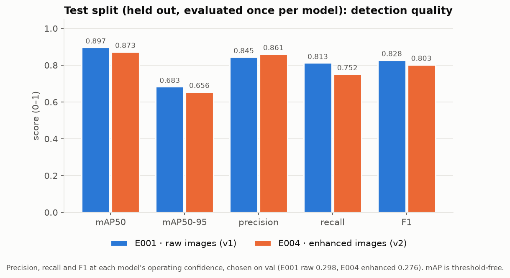
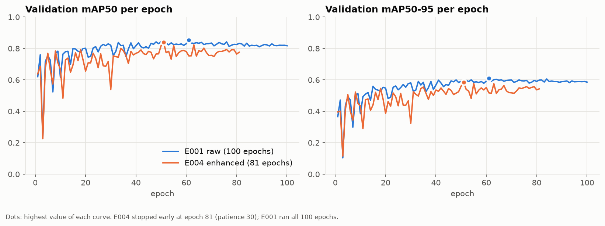
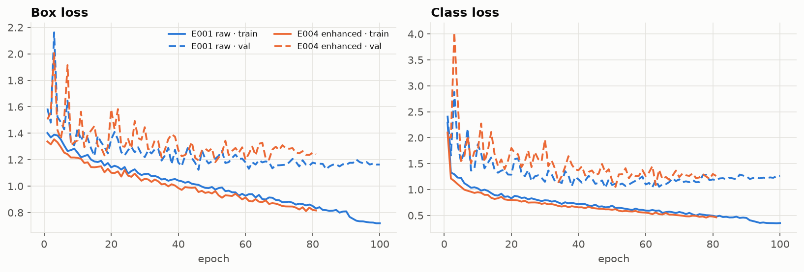
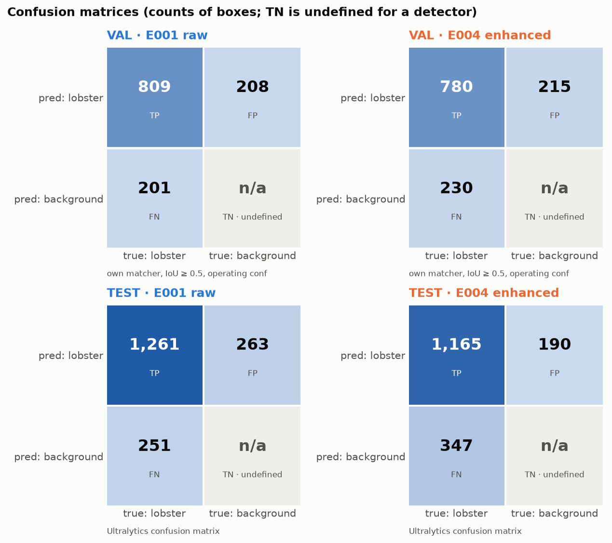
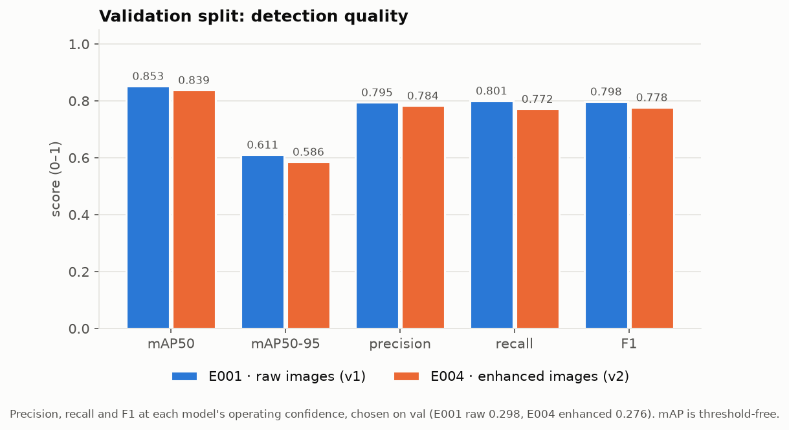
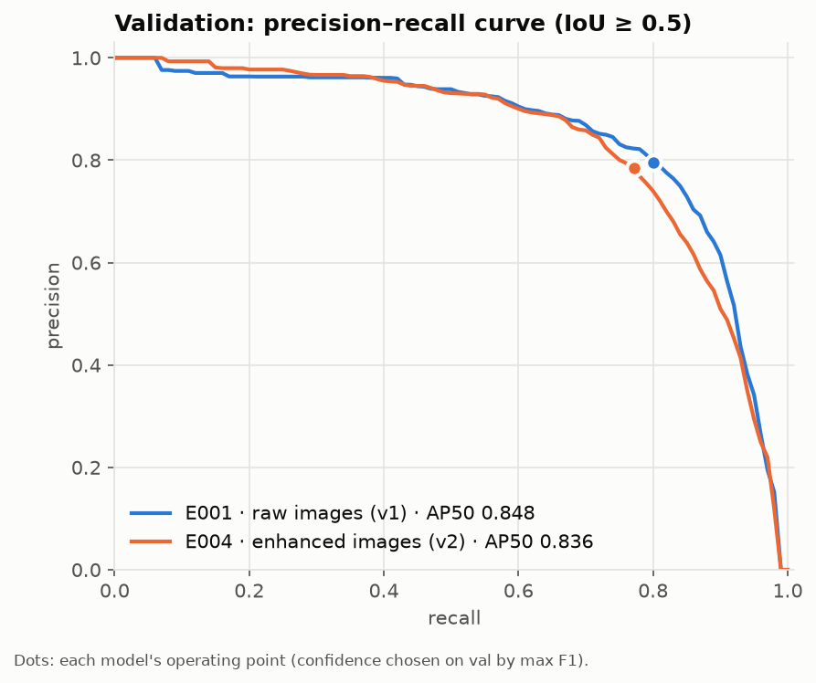
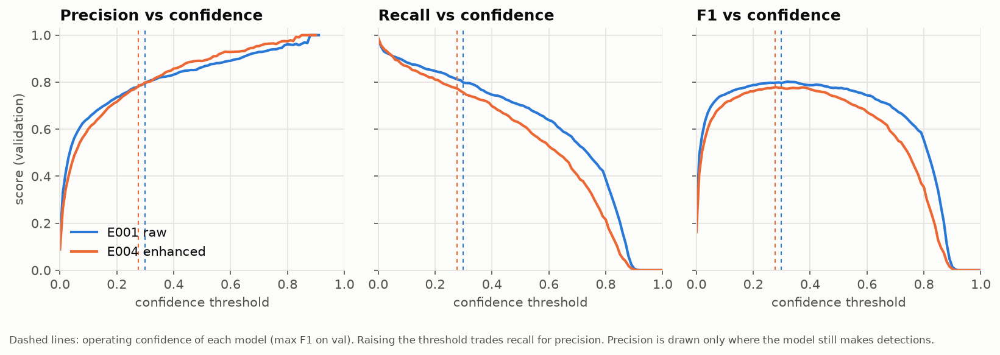
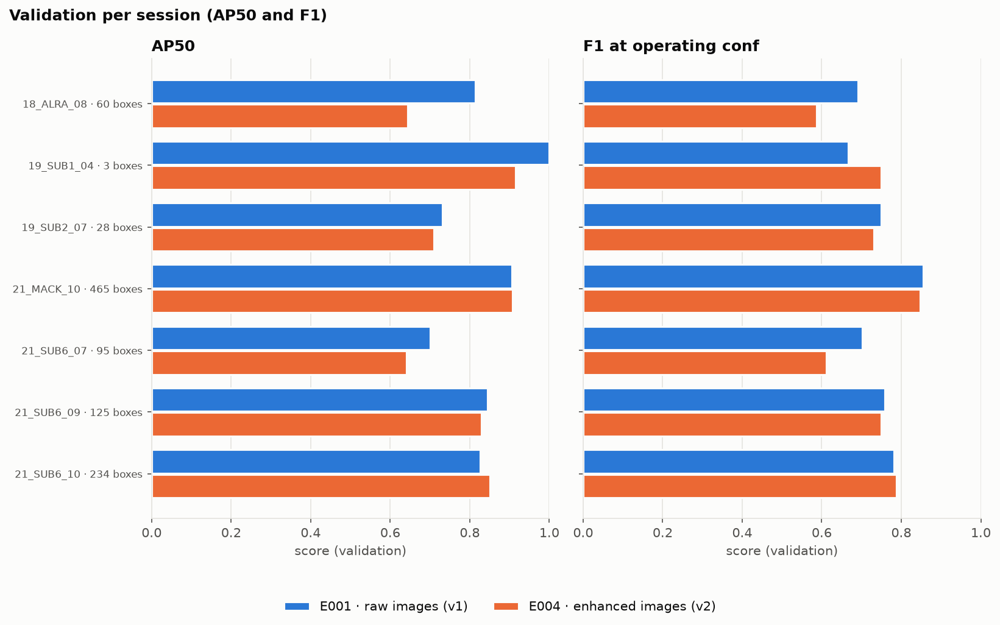
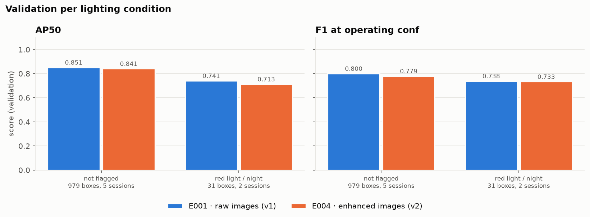
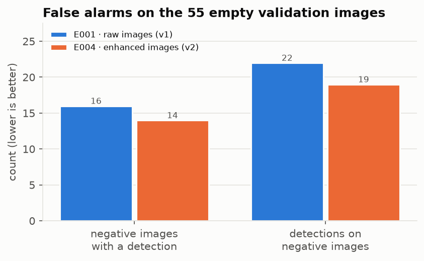

# Lobster detection: raw vs enhanced images (E001 vs E004)

Underwater Creature Tracking project · first class `0: lobster` · report generated from the
committed experiment records by `scripts/make_report.py` (every number and chart below is read
from `experiments/records/E001/` and `experiments/records/E004/`; nothing is typed by hand).

> **Key findings**
>
> - **The enhancement did not help.** On the held-out test split, E004 (enhanced) is below E001
>   (raw): mAP50 0.873 vs 0.897, recall 0.752 vs 0.813,
>   F1 0.803 vs 0.828.
> - **It misses more lobsters:** 347 vs 251 missed boxes on test. It raises fewer
>   false alarms on test (190 vs 263) but not on validation
>   (215 vs 208), so that is not a reliable advantage.
> - **Both models struggle in the same places:** `21_SUB6_07` (AP50 0.70 raw → 0.64 enhanced); `19_SUB2_07` (AP50 0.73 raw → 0.71 enhanced); red-light/night images (AP50 0.74 raw → 0.71 enhanced, only 31 boxes).
> - **Same cost:** 9.9 M parameters and about 20 ms per image on a
>   Tesla T4 for both, so the comparison isolates the images.
> - **Caveat:** one training run per model, and E004 stopped at 81 epochs vs
>   100. More seeds would confirm the size of the gap.
> - **Recommendation** (project judgement, not a measured result): keep the raw images (E001) as the
>   baseline; next compare detector architectures (RT-DETR, E003) and image size (E002).

## 1. Summary

**Question.** Does a teammate's colour enhancement of the underwater images (Harsh's
`fusion_mild` green-water correction, D-017/D-018) improve lobster detection for the same
YOLO detector?

**Design.** Two training runs that differ in one thing only, the images: **E001** trains on the raw
images (dataset v1), **E004** on the enhanced copies of exactly the same images (dataset v2: same
recording sessions, same train/val/test split, same labels). Same model (`yolo26s.pt`), image size,
settings, seed and GPU type.

**Result on the held-out test split** (evaluated once per model, after the model was fixed):

| metric | E001 raw | E004 enhanced | difference |
| --- | ---: | ---: | ---: |
| mAP50 | 0.897 | 0.873 | −0.024 |
| mAP50-95 | 0.683 | 0.656 | −0.028 |
| precision | 0.845 | 0.861 | +0.017 |
| recall | 0.813 | 0.752 | −0.061 |
| F1 | 0.828 | 0.803 | −0.025 |
| operating confidence (chosen on val) | 0.298 | 0.276 |  |

- OBSERVED: on test, E004 scores **lower** than E001 on mAP50, mAP50-95, recall and F1, and
  **higher** on precision: it raises fewer false alarms but misses more lobsters.
- OBSERVED: validation agrees on mAP50, mAP50-95, recall and F1 (all lower for E004), but not on
  precision: at the operating confidence E004's val precision is slightly lower
  (0.784 vs 0.795) and it has 215 false positives vs
  208. The precision difference is therefore not consistent across splits.
- INFERRED: on this data the enhancement did **not** improve detection with this detector.
- HYPOTHESIS, not tested: part of the gap could be run-to-run noise (one run per model) or E004's
  shorter training (it stopped early at epoch 81; E001 ran 100 epochs).

## 2. Data

| split | images | with lobsters | empty (negative) | lobster boxes |
|---|---:|---:|---:|---:|
| train | 1433 | 1274 | 159 | 4000 |
| val | 324 | 269 | 55 | 1010 |
| test | 348 | 321 | 27 | 1512 |

- Images are frames from GoPro deployments (Set 100 + Set 2000). The split is **by recording
  session**, so no session appears in two splits.
- **Train** fits the model; **val** chooses the checkpoint and the confidence threshold; **test** is
  held out and was used exactly once per model (CLAUDE.md rule 7).
- zExtra photos are excluded (never labelled).

## 3. Training runs

| run | what changed | dataset | model | imgsz | epochs | seed | highest val mAP50 |
| --- | --- | --- | --- | ---: | ---: | ---: | ---: |
| E001 | baseline | v1 | yolo26s.pt | 640 | 100 | 0 | 0.853 |
| E004 | images raw -> enhanced (dataset v1 -> v2, D-017) | v2 | yolo26s.pt | 640 | 81 | 0 | 0.838 |

## 4. Test results (held out)

| metric | E001 raw | E004 enhanced | difference |
| --- | ---: | ---: | ---: |
| mAP50 | 0.897 | 0.873 | −0.024 |
| mAP50-95 | 0.683 | 0.656 | −0.028 |
| precision | 0.845 | 0.861 | +0.017 |
| recall | 0.813 | 0.752 | −0.061 |
| F1 | 0.828 | 0.803 | −0.025 |
| operating confidence (chosen on val) | 0.298 | 0.276 |  |

Ultralytics also reports precision/recall at the confidence that maximises F1 *on test itself*
(not a usable operating point, shown for completeness): E001 0.831 /
0.821, E004 0.834 /
0.780.

### Confusion matrices

| test (Ultralytics matrix) | E001 raw | E004 enhanced | difference |
| --- | ---: | ---: | ---: |
| TP | 1,261 | 1,165 | −96 |
| FP | 263 | 190 | −73 |
| FN | 251 | 347 | +96 |

| val (IoU ≥ 0.5, operating conf) | E001 raw | E004 enhanced | difference |
| --- | ---: | ---: | ---: |
| TP | 809 | 780 | −29 |
| FP | 208 | 215 | +7 |
| FN | 201 | 230 | +29 |

- **TP**: a lobster box found. **FP**: a detection with no lobster box under it (false alarm,
  including duplicate or badly placed boxes). **FN**: a lobster box the model missed.
- TN (background predicted as background) is undefined for a detector, so that cell is empty.
- The test matrix is Ultralytics' own (its internal matching settings); the val matrix uses the
  project's matcher at IoU ≥ 0.5 and each model's operating confidence (D-020). Compare within a
  row, not across the two tables.

## 5. Validation results in detail

| metric | E001 raw | E004 enhanced | difference |
| --- | ---: | ---: | ---: |
| mAP50 | 0.853 | 0.839 | −0.014 |
| mAP50-95 | 0.611 | 0.586 | −0.025 |
| precision | 0.795 | 0.784 | −0.012 |
| recall | 0.801 | 0.772 | −0.029 |
| F1 | 0.798 | 0.778 | −0.020 |
| operating confidence (chosen on val) | 0.298 | 0.276 |  |

### Precision–recall and the confidence threshold

### Per session

| session | images | boxes | AP50 E001 | AP50 E004 | F1 E001 | F1 E004 | FP E001 / E004 |
| --- | ---: | ---: | ---: | ---: | ---: | ---: | ---: |
| `18_ALRA_08_CW_20220616` | 36 | 60 | 0.814 | 0.644 | 0.691 | 0.587 | 31 / 17 |
| `19_SUB1_04_CW_20220621` | 36 | 3 | 1.000 | 0.916 | 0.667 | 0.750 | 3 / 2 |
| `19_SUB2_07_CW_20220622` | 36 | 28 | 0.731 | 0.709 | 0.750 | 0.731 | 7 / 5 |
| `21_MACK_10_BW_20220815` | 54 | 465 | 0.906 | 0.908 | 0.856 | 0.847 | 75 / 66 |
| `21_SUB6_07_BW_20220812` | 54 | 95 | 0.701 | 0.640 | 0.702 | 0.611 | 29 / 55 |
| `21_SUB6_09_BW_20220815` | 54 | 125 | 0.845 | 0.829 | 0.759 | 0.749 | 32 / 42 |
| `21_SUB6_10_BW_20220815` | 54 | 234 | 0.826 | 0.850 | 0.782 | 0.787 | 31 / 28 |

### Per lighting condition

| lighting | sessions | boxes | AP50 E001 | AP50 E004 | P / R E001 | P / R E004 |
| --- | ---: | ---: | ---: | ---: | ---: | ---: |
| not flagged | 5 | 979 | 0.851 | 0.841 | 0.799 / 0.802 | 0.785 / 0.774 |
| red light or night | 2 | 31 | 0.741 | 0.713 | 0.706 / 0.774 | 0.759 / 0.710 |

### False alarms on empty images

The validation split has 55 confirmed-empty images (no lobster).
E001 fired on 16 of them (22 detections),
E004 on 14 (19 detections).

## 6. Model cost

|  | E001 raw | E004 enhanced |
| --- | ---: | ---: |
| parameters | 9,948,638 | 9,948,638 |
| GFLOPs at 640 px | 22.7 | 22.7 |
| inference time per image, batch 1, median (Tesla T4) | 19.6 ms | 19.6 ms |

Same architecture, so the cost is the same; the enhancement step itself is not timed here.

## 7. Limitations (read before quoting any number)

- **New sessions, not new sites.** Test sessions share sites (mostly also dates) with training
  sessions, so these results measure generalisation to new recording sessions, not to new sites
  (D-007).
- **Concentrated boxes.** Two test sessions hold 1,135 of 1,512 test boxes (D-008); one val
  session (`21_MACK_10`) holds 465 of 1,010 val boxes.
- **One run per model** (seed 0); small differences may be run-to-run noise. E004 stopped early at
  81 epochs, E001 ran 100.
- **Validation is optimistic.** Val chose each run's checkpoint and its operating confidence.
- **Red-light/night val** is only 2 sessions / 31 boxes, so per-lighting results are fragile.
- **Enhancement provenance.** One val and one test image were among the images the enhancement's
  author reviewed while choosing its settings; whether others were seen is UNKNOWN (D-022). A
  five-image re-run matches the delivered images to within 0.01% of pixels (D-023).
- **Environment.** E004's test ran on a newer Colab CUDA (13.0) than its training (12.8); same GPU
  type and Ultralytics version.
- **Metadata.** Substrate and visibility metadata are mostly missing; zExtra is excluded.
- Sizes and positions are in pixels only; there is no camera calibration (CLAUDE.md rule 9).

## 8. Glossary

- **Precision**: of the boxes the model drew, the share that really are lobsters.
- **Recall**: of the real lobsters, the share the model found.
- **F1**: one number balancing precision and recall (their harmonic mean).
- **IoU**: overlap between a predicted box and a true box (0 = none, 1 = identical); a match here
  needs IoU ≥ 0.5.
- **mAP50**: average precision over all confidence thresholds, matching at IoU ≥ 0.5.
  **mAP50-95** averages it over stricter overlaps (IoU 0.5 to 0.95), so it also rewards tight boxes.
- **Operating confidence**: the threshold the model uses in practice, chosen on val where F1 is
  highest, then frozen before the test.

## Sources

- Records: `experiments/records/E001/`, `experiments/records/E004/` (run_record.json, results.csv,
  val_eval_record.json, final_test_record.json).
- Decisions: `docs/DECISIONS.md` (D-007, D-008, D-013, D-017, D-018, D-020, D-022, D-023).
- Experiment log: `docs/EXPERIMENTS.md`. Ultralytics' own plots and prediction examples are on the
  project Drive in `uwct/runs/<id>/final_test/` and `uwct/runs/<id>/val_eval/`.
