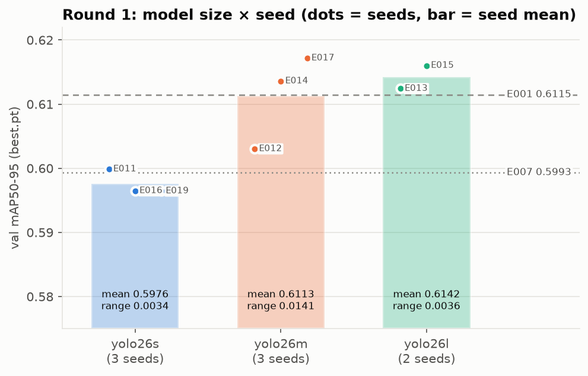
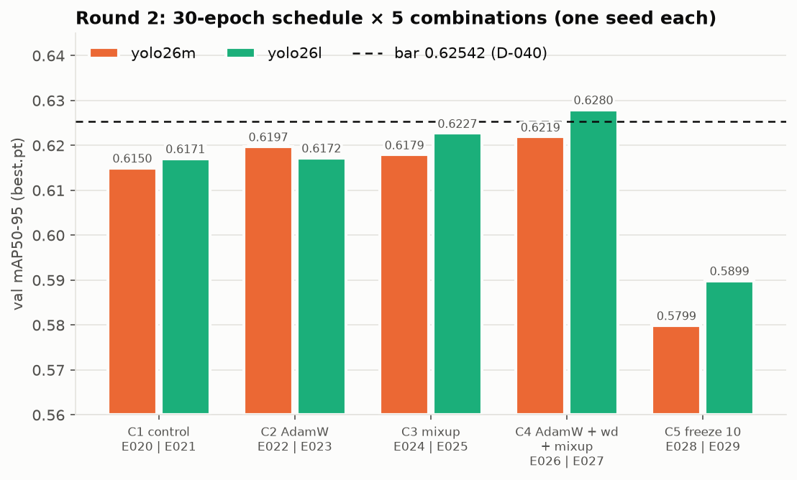
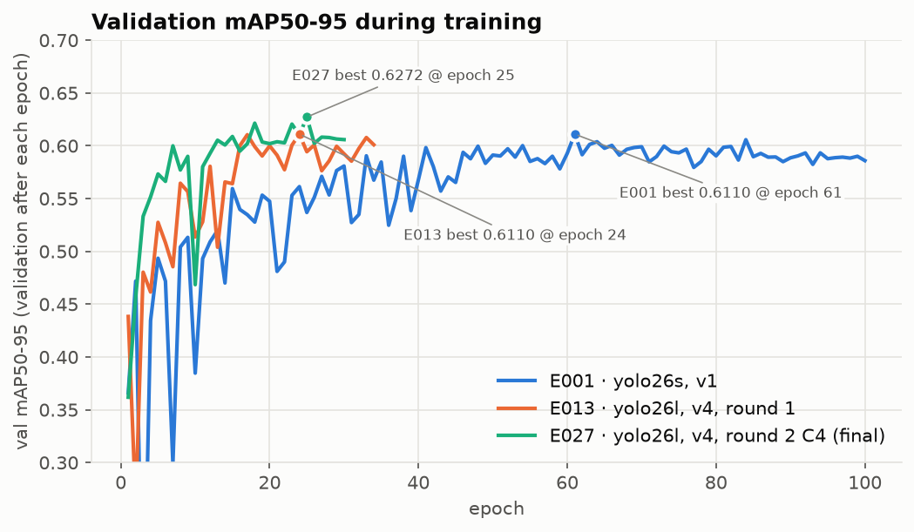
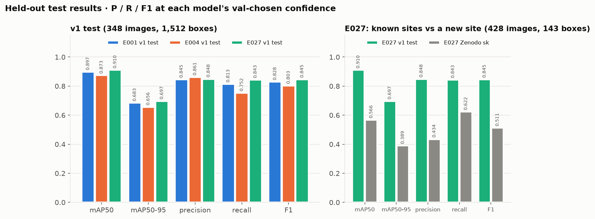
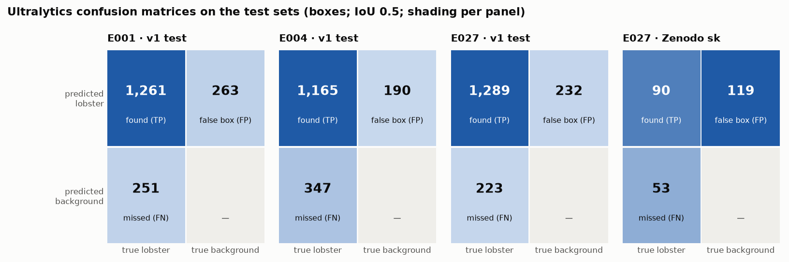
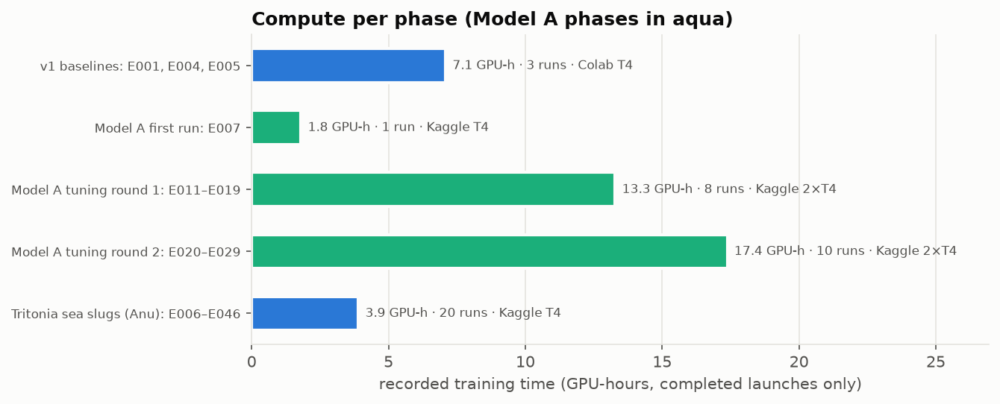

# Final report data pack: underwater lobster detection

Underwater Creature Tracking project · class `0: lobster` · built by `scripts/make_final_report.py` from the committed records (`experiments/registry.csv`, `experiments/records/`, `data/processed/v4/`). Every number is computed from those files except the few in the *Quoted numbers* table at the end, which name their source. This is source material for the report and slides, not the report itself. Claims are marked OBSERVED / INFERRED / LIMITATION (CLAUDE.md §3).

> **Key numbers (OBSERVED)**
>
> - **Final model E027** (YOLO26l, dataset v4, round-2 combination C4) on the held-out v1 test: mAP50-95 **0.697**, mAP50 0.910, P / R / F1 0.848 / 0.843 / 0.845 at the val-chosen conf 0.269.
> - **Against the GUI's earlier model E001** (YOLO26s, v1) on the same test: mAP50-95 0.683 → 0.697 (+0.0134), recall 0.813 → 0.843, missed boxes 251 → 223, false boxes 263 → 232.
> - **At a new site** (Zenodo sk, never trained on): mAP50-95 0.389, precision 0.434 at the same conf: the model does not transfer well to an unfamiliar site.
> - **Tuning:** 8 round-1 runs (3 sizes × 3 seeds, 1 skipped for time) + 10 round-2 runs (5 combinations × 2 sizes); one run cleared the pre-declared bar 0.62542: E027.
> - **Compute:** 39.6 GPU-hours of recorded training for the lobster detector, 43.5 including the Tritonia sea-slug runs (completed launches only).

## 1. What was built, and the order it happened in

Pipeline: raw frames → audit → session-level split → image manifest → YOLO dataset view → training (Colab / Kaggle GPU) → val-only selection → one declared test evaluation → local Streamlit GUI for inspection. Every stage communicates through committed files; every decision is in `docs/DECISIONS.md`.

| phase | what | decisions |
| --- | --- | --- |
| Data foundation (Sept) | raw audit, session split, frozen v1, raw fingerprint | D-001–D-011 |
| v1 baselines (Sept–Oct) | E001 YOLO26s raw; E004 enhanced images (v2); E005 RT-DETR (E003 diverged) | D-012–D-027 |
| Val-only evaluation (Oct) | per-session / per-lighting val metrics, IoU 0.5 matching fixed first | D-020 |
| Model A data (Nov) | Harsh's mixed data on our split, leakage check, frozen v4 | D-031, D-032 |
| Model A tuning (Nov 11–13) | round 1 size × seed, round 2 combinations, E027 selected | D-038–D-040, D-043 |
| Final test (Nov 13) | E027 on v1 test and Zenodo sk, once each | D-043 |
| E027 val-only evaluation (Nov 16) | false positives on empty val images, per session / lighting | D-020 |
| Tritonia sea slugs (Anu, Nov) | second species, timelapse, point evaluation | D-029/D-030, D-033–D-037, D-041/D-042 |

## 2. Data

**Split rule (D-001):** the unit is the recording session; all files of a session stay in one split. The v1 val and test frames are kept unchanged in every later version, so all lobster models are scored on the same 324 val and 348 test images.

**Dataset v4 (Model A, D-031/D-032), images per split, origin and kind** (from `data/processed/v4/mixed_manifest.csv`):

| split | origin | original | colour change | copy-paste | diffusion | total |
| --- | --- | ---: | ---: | ---: | ---: | ---: |
| train | ours | 1,312 | 192 | 516 | 1,312 | 3,332 |
| train | zenodo | 480 | 93 | 206 | 0 | 779 |
| val | ours | 324 | 0 | 0 | 0 | 324 |
| test (v1) | ours | 348 | 0 | 0 | 0 | 348 |
| test_zenodo_sk | zenodo | 428 | 0 | 0 | 0 | 428 |

Train: 4,111 images (3,721 with lobsters, 390 confirmed empty, 11,784 boxes). Val 324 images / 1,010 boxes; v1 test 348 images (27 empty) / 1,512 boxes; Zenodo sk 428 images (285 empty) / 143 boxes.

Not built into v4: 992 ancestor not train; 90 label review excluded; 65 ancestor label excluded; 31 label review low confidence empty; 24 zenodo no site ("ancestor not train" = a derived image whose source frame or pasted crop comes from a v1 val/test session, removed by the leakage check).

Zenodo data: dataset 15755673, CC BY 4.0 (credit required). Site `mpa` is used in training; site `sk` is held out as the only new-site test (D-031).

LIMITATIONS (§3): v1 test sessions share sites (mostly also dates) with train sessions, so the v1 test measures new sessions, not new sites (D-007); substrate/visibility metadata is mostly missing; zExtra (436 frames, no labels) is excluded and used only for qualitative GUI inspection.

## 3. Models and experiments

All lobster runs are YOLO26 (Ultralytics 8.4.155, COCO-pretrained checkpoints) except E005 (RT-DETR-l), at 640 px. One committed config per run names its parent and what changed; the full list with hyperparameters is in `final_report_experiments.csv`.

| run | model | data | epochs | val P | val R | val mAP50 | val mAP50-95 | change vs parent |
| --- | --- | --- | ---: | ---: | ---: | ---: | ---: | --- |
| E001 | yolo26s | v1 | 100 | 0.7998 | 0.7901 | 0.8527 | 0.6115 | initial baseline (no parent experiment) |
| E004 | yolo26s | v2 | 81 | 0.8056 | 0.7465 | 0.8385 | 0.5864 | images raw -> enhanced (dataset v1 -> v2, D-017) |
| E005 | rtdetr-l | v1 | 100 | 0.7710 | 0.8139 | 0.8359 | 0.5884 | model yolo26s.pt -> rtdetr-l.pt (as E003); amp true -> false (E003 div… |
| E007 | yolo26s | v4 | 58 | 0.8021 | 0.7783 | 0.8423 | 0.5993 | dataset v1 -> v4 (all safe Model A training data, D-031/D-032) |
| E027 | yolo26l | v4 | 30 | 0.7792 | 0.8307 | 0.8537 | 0.6280 | final model (round 2, C4) |

Not registered: E002 (imgsz 1280, planned, not run), E003 (RT-DETR with AMP: diverged to NaN, rerun as E005, D-025), E018 (yolo26l seed 2: not run, round-1 time limit), E009 (Tritonia, run record lost).

## 4. How the model was tuned

**Practices (all fixed before the runs they govern):**

- One selection metric, declared before any comparison: val mAP50-95 (D-038 point 1). It picks the best epoch inside a run (Ultralytics fitness) and the best run, so one criterion is used throughout.
- Test data never chooses anything: val (324 images) for every choice, the v1 test and Zenodo sk only once, for the run declared in `experiments/final_candidates.csv` beforehand (CLAUDE.md rule 7).
- Seeds measure noise: round 1 ran each model size with 3 seeds, and the seed range became the bar a change must clear (D-038 point 4, D-040 point 4).
- Simplest model wins ties: a bigger model is chosen only if its gain over a smaller one exceeds the seed range.
- Committed config per run (parent + what changed), frozen dataset (v4 fingerprint verified in every run), run record with git commit, seed, environment and best.pt sha256; every package re-checked by sha256.
- Time-boxed queue: two runs in parallel on Kaggle's 2×T4, a run started only if its worst case finished before the deadline, so no run was ever cut off and skipped runs are recorded as "not run (time)".
- Ultralytics `model.tune()` (genetic search) was not used: it needs dozens to hundreds of runs (D-038 point 9).

**Round 1 (D-038/D-039): which model size?** yolo26s / m / l × seeds 0 / 1 / 2 on v4, 60-epoch ceiling, patience 10, otherwise as E007.

| model | seed 0 | seed 1 | seed 2 | mean | range |
| --- | --- | --- | --- | ---: | ---: |
| yolo26s | E011 0.5999 | E016 0.5965 | E019 0.5965 | 0.5976 | 0.0034 |
| yolo26m | E012 0.6030 | E014 0.6136 | E017 0.6172 | 0.6113 | 0.0141 |
| yolo26l | E013 0.6124 | E015 0.6160 | E018 not run (time) | 0.6142 | 0.0036 |

OBSERVED: the highest mean is yolo26l (0.6142). Gap to yolo26m 0.0030 ≤ yolo26m's range 0.0141, so no evidence l beats m; gap to yolo26s 0.0166 > both ranges. Rule (D-040 point 1) → **yolo26m** selected, yolo26l kept for round 2 at the user's request. OBSERVED in `results.csv`: no round-1 run completed its schedule (all stopped by patience at epochs 26–41 of 60), so none trained with an annealed learning rate or without mosaic (D-040 context 4). That motivated round 2's shorter schedule that always completes.

**Round 2 (D-040): which settings?** Every run uses a 30-epoch schedule with patience 30 (the learning rate decays fully; the last 10 epochs train without mosaic), on yolo26m and yolo26l, seed 0. A run replaces the round-1 choice only if its val mAP50-95 is above the bar = yolo26m mean + range = **0.62542**.

|  | added to the schedule | yolo26m | yolo26l |
| --- | --- | --- | --- |
| C1 | schedule only (control) | E020 0.6150 | E021 0.6171 |
| C2 | + AdamW lr0 0.001 | E022 0.6197 | E023 0.6172 |
| C3 | + mixup 0.1 | E024 0.6179 | E025 0.6227 |
| C4 | + AdamW lr0 0.001, weight_decay 0.001, mixup 0.1 | E026 0.6219 | E027 0.6280 |
| C5 | + freeze 10 (backbone frozen) | E028 0.5799 | E029 0.5899 |

OBSERVED: only E027 clears the bar (margin 0.00254) → selected and declared alone (D-043). C4 is the best combination for both sizes; freezing the backbone (C5) is clearly worse; the completed schedule alone (C1) is within round-1 seed noise (INFERRED, single seeds).

E027 trained 30 epochs, best epoch 25 (val mAP50-95 0.6272 in `results.csv`; the final validation of best.pt after training gives 0.6280, the value used for selection), 1.82 h on one T4 (sharing the session with a second run).

LIMITATION: 19 configurations were compared on the same 324 val images, so E027's val score is optimistic; its margin over the bar (0.00254) is smaller than yolo26m's seed range (0.01415), so another seed could fall below it. Only the test results below are unbiased.

## 5. Final evaluation (held-out, once per model)

| model | mAP50 | mAP50-95 | conf (val) | P | R | F1 | TP / FP / FN |
| --- | ---: | ---: | ---: | ---: | ---: | ---: | --- |
| E001 (yolo26s, v1) | 0.897 | 0.683 | 0.298 | 0.845 | 0.813 | 0.828 | 1261 / 263 / 251 |
| E004 (yolo26s, v2) | 0.873 | 0.656 | 0.276 | 0.861 | 0.752 | 0.803 | 1165 / 190 / 347 |
| E005 (rtdetr-l, v1) ¹ | 0.879 | 0.660 | 0.619 | 0.841 | 0.771 | 0.805 | not comparable ² |
| **E027** (yolo26l, v4) | 0.910 | **0.697** | 0.269 | 0.848 | 0.843 | 0.845 | 1289 / 232 / 223 |
| E027 on **Zenodo sk** (new site) | 0.566 | 0.389 | 0.269 | 0.434 | 0.622 | 0.511 | 90 / 119 / 53 |

All rows except the last: the same v1 test (348 images, 27 empty, 1,512 boxes). P / R / F1 at each model's own val-chosen confidence (max mean F1 on val). TP / FP / FN from Ultralytics' confusion matrix. ¹ quoted from docs/EXPERIMENTS.md (record on Drive). ² RT-DETR's matrix may use another confidence threshold (UNKNOWN, EXPERIMENTS.md).

- OBSERVED: among the four v1 models, E027 is highest on mAP50, mAP50-95, recall, F1; not on precision (E004 0.861 vs 0.848). Against E001 it finds 28 more lobsters with 31 fewer false boxes. Test mAP50-95 is higher than val for E001, E004, E027 (E027 0.6966 vs 0.6280). INFERRED: the v1 test frames are easier than the val frames for these models, so val and test numbers are not interchangeable; compare models within one split.
- OBSERVED: on Zenodo sk, 119 false boxes against 90 found lobsters, 53 of 143 missed. INFERRED: the val-chosen confidence is too low for sk (at sk's own max-F1 confidence Ultralytics reports P 0.732 / R 0.490, but choosing a threshold on sk is not allowed).
- INFERRED, not tested: the gain over E001 comes from more data (v4) and the larger model together; there is no run that separates the two (E007 = v4 with yolo26s: val 0.5993, below E001's 0.6115).
- UNKNOWN (records keep no per-image predictions): false positives on the empty test images, and per-session test results for E027.

**Val-only secondary metrics (D-020):** `scripts/val_eval.py` re-runs each model's best.pt on the 324 val images with its own matcher (IoU ≥ 0.5, greedy) at the val-chosen confidence, and keeps per-image results, so it can count false positives on the 55 lobster-free val images and split results by session and lighting.

| model | conf (val) | TP / FP / FN | P / R / F1 | AP50 | empty images with a detection (dets) | red-light AP50 / R | not-flagged AP50 / R |
| --- | ---: | --- | ---: | ---: | --- | --- | --- |
| E001 (yolo26s, v1) | 0.298 | 809 / 208 / 201 | 0.795 / 0.801 / 0.798 | 0.848 | 16 of 55 (22) | 0.741 / 0.774 | 0.851 / 0.802 |
| E004 (yolo26s, v2) | 0.276 | 780 / 215 / 230 | 0.784 / 0.772 / 0.778 | 0.836 | 14 of 55 (19) | 0.713 / 0.710 | 0.841 / 0.774 |
| **E027** (yolo26l, v4) | 0.269 | 838 / 239 / 172 | 0.778 / 0.830 / 0.803 | 0.848 | 19 of 55 (22) | 0.801 / 0.806 | 0.851 / 0.830 |

- OBSERVED: at its val-chosen confidence E027 finds 29 more of the 1,010 val boxes than E001 with 31 more false boxes; own-matcher AP50 0.848 vs 0.848 (equal at 3 decimals). It puts a detection on 19 of the 55 lobster-free val images (E001 16); 10 of those are red-light frames.
- OBSERVED: among the 5 val sessions with at least 50 boxes, the lowest precision is 18_ALRA_08_CW_20220616 (P 0.537, 44 false boxes for 51 found lobsters). Per-session tables: `docs/EXPERIMENTS.md`, section "Val secondary metrics: E027 (D-020)".
- LIMITATION: val also chose each checkpoint, each confidence and E027 itself, so these numbers are optimistic; red-light val is 2 sessions / 31 boxes. They compare models; they do not estimate deployment quality.

## 6. The GUI model: before and after

|  | before: E001 | now: E027 |
| --- | --- | --- |
| model | YOLO26s | YOLO26l |
| training data | v1: 1,433 raw frames | v4: 4,111 images (originals + Zenodo mpa + derived copies) |
| val mAP50-95 | 0.6115 | 0.6280 |
| v1 test mAP50-95 / mAP50 | 0.6832 / 0.8974 | 0.6966 / 0.9096 |
| v1 test P / R / F1 (val conf) | 0.845 / 0.813 / 0.828 | 0.848 / 0.843 / 0.845 |
| v1 test found / false / missed | 1261 / 263 / 251 | 1289 / 232 / 223 |
| Zenodo sk mAP50-95 | never evaluated | 0.3892 |
| operating confidence (chosen on val) | 0.298 | 0.269 |
| best.pt size | 20.3 MB | 52.9 MB |
| inference on a Tesla T4 (test run) ³ | 6.1 ms/image | 19.5 ms/image |
| parameters / GFLOPs (640 px) | 9.95 M / 22.7 | 26.18 M / 93.5 |
| inference, batch 1, median on a Tesla T4 (val eval) ⁴ | 16.3 ms/image | 26.0 ms/image |
| val: empty images with a detection (of 55) | 16 | 19 |

³ Ultralytics' own timing during each test run: different sessions (Colab 2026-09-19 vs Kaggle 2026-11-13) and library builds, so a rough guide to the size difference, not a benchmark.
⁴ `val_eval.py`, one image at a time, first image dropped as warm-up; same GPU type for both (Colab 2026-10-11 vs Kaggle 2026-11-16), so closer to a like-for-like comparison than ³, still not a benchmark.

The GUI (`scripts/gui_app.py`) now offers E027 (default), E001 and E004, shows each model's recorded scores, can run E027 and E001 side by side on the same image at their own validated settings, and can browse the Zenodo sk frames. It computes no metric; per-image counts are observations (rule 7).

## 7. Compute

| phase | platform | runs | GPU-hours | interrupted launches not counted |
| --- | --- | ---: | ---: | ---: |
| v1 baselines: E001, E004, E005 | Colab T4 | 3 | 7.09 | 6 |
| Model A first run: E007 | Kaggle T4 | 1 | 1.80 | 0 |
| Model A tuning round 1: E011–E019 | Kaggle 2×T4 | 8 | 13.29 | 0 |
| Model A tuning round 2: E020–E029 | Kaggle 2×T4 | 10 | 17.38 | 0 |
| Tritonia sea slugs (Anu): E006–E046 | Kaggle T4 | 20 | 3.90 | 0 |
| **total** |  | 42 | **43.47** |  |

GPU-hours = recorded training time of completed launches (`run_record.json` → duration), summed per run; two runs sharing a 2×T4 session count twice. Interrupted launches (E001: 2, E005: 4) have no end time, so the Colab figure is a lower bound. Excluded: smoke tests, dataset builds, evaluations and the unregistered E003 / E009 runs. Kaggle sessions (wall clock, quoted): round 1 about 7.4 h, round 2 about 9.0 h; Kaggle counts one quota hour per session hour whatever the number of GPUs (D-040). Quota used after round 1: 12 of 30 h (quoted); after round 2 and the final test: UNKNOWN — read the quota meter.

## 8. What the selection metric means (D-038 point 8)

mAP50 counts a detection as correct when its box overlaps the annotated box with IoU ≥ 0.5: *was the lobster found?* mAP50-95 averages the same score over IoU thresholds 0.50, 0.55, …, 0.95, so it also rewards tight boxes. Trajectories are built from box positions in pixels, so both finding the lobster and placing the box accurately matter; mAP50-95 measures both, and Ultralytics already uses it to pick the best epoch, so one criterion runs from epoch to final choice. LIMITATION: neither is a tracking metric (no ground-truth track IDs for lobsters, CLAUDE.md rule 9); the operating confidence (precision/recall trade-off) is chosen separately on val.

## 9. What the final model can and cannot do

- OBSERVED: on new recording sessions at known sites it finds about 84% of lobster boxes with about 85% of its boxes correct (v1 test, val-chosen conf).
- OBSERVED: it was trained on a mix of our raw frames, Zenodo mpa frames and three kinds of synthetic or augmented copies (colour change, copy-paste, diffusion); it is evaluated on raw frames only.
- OBSERVED: at a new site (Zenodo sk) quality drops sharply (mAP50-95 0.389); expect many false boxes and missed lobsters on footage from a new location until it is fine-tuned there.
- LIMITATION: one class (lobster); pixels only (no calibration, so no sizes in cm, rule 9); boxes, not outlines.
- LIMITATION: one seed of the final configuration; leave-site-out cross-validation was deferred (D-038 point 9).

## 10. Second species: Tritonia sea slugs (Anu)

20 registered runs (datasets v3–v8, 3.9 GPU-hours), scored by point AP against the clicked MTrackJ crosses (D-033), not by box mAP. Final tests: E006 point AP 0.248 and E010 0.2145 (quoted). The tracking work (T002) was in open PR #27 on 2026-11-13, not yet on the integration branch, so it is not covered here.

## 11. Open gaps (UNKNOWN until measured)

- False positives on empty test images (27 v1, 285 sk) and per-session test results: the final-test records keep no per-image predictions; measuring them would need a new decision.
- A second seed of E027's configuration, and leave-site-out cross-validation (D-038 point 9).
- Kaggle quota left after round 2 and the final test.

## Quoted numbers (not computed from a committed record)

| number | value | source |
| --- | --- | --- |
| E005 test | {"mAP50": 0.8788, "mAP50-95": 0.6604, "precision": 0.8411, "recall": 0.7712, "F1": 0.8046, "conf": 0.619} | docs/EXPERIMENTS.md, Test-evaluation log (E005 record is on Drive, not in the repository) |
| round1 session h | 7.4 | D-040 context 1 (Kaggle round-1 notebook log) |
| round2 session h | 9.0 | D-043 context 1 (Kaggle round-2 notebook log) |
| quota after round1 h | 12.0 | D-040 context 5 (Kaggle quota meter, read by the user) |
| tritonia test point ap | {"E006": 0.248, "E010": 0.2145} | docs/EXPERIMENTS.md, Test-evaluation log (point AP against the MTrackJ crosses, D-033) |

Ultralytics' own plots (PR curves, confusion matrices, sample predictions) are off-repo with the run packages: E027 val in the round-2 output (`E027_package.zip`, sha256 `55a58487…`), test and sk in the final-test output (`E027_final_test_package.zip`, sha256 `c72921ca…`).
